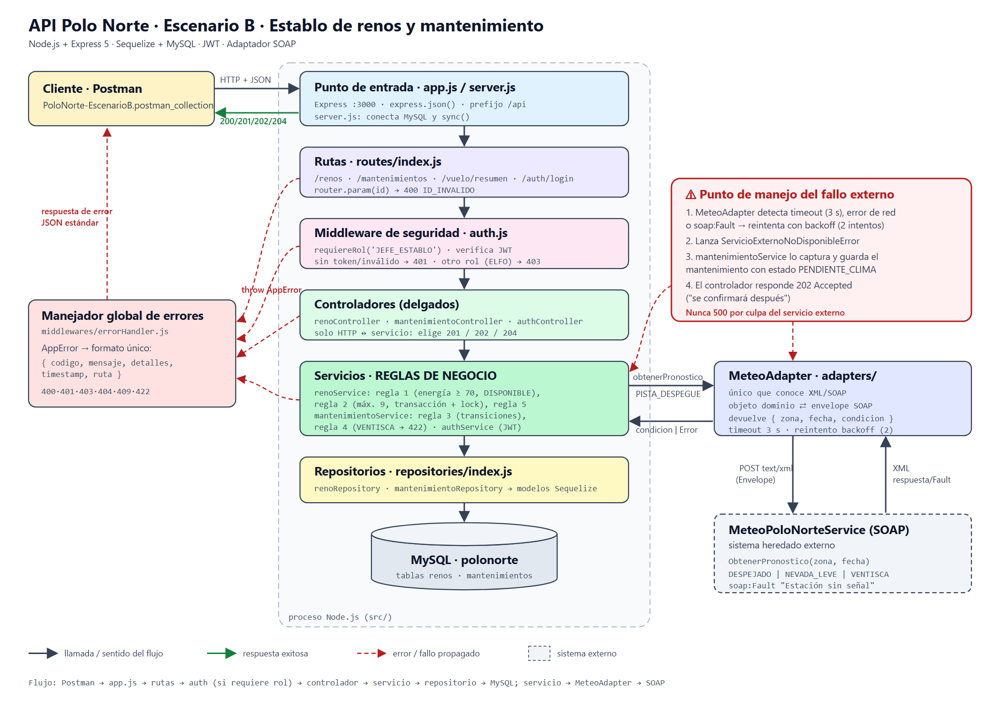

# 🦌 API Polo Norte · Escenario B · Establo de renos y mantenimiento del terreno

API REST para gestionar los renos, las tareas de mantenimiento del terreno y la asignación al vuelo del 24 de diciembre. Se integra con el servicio SOAP heredado **MeteoPoloNorteService** y sigue funcionando cuando ese servicio falla.

**Stack:** Node.js 22 · Express 5 · Sequelize + MySQL 8 · JWT · axios + fast-xml-parser (SOAP) · Jest + Supertest · Postman/Newman

---

## 1. Cómo levantar el proyecto

Requisitos: Node.js 18 o superior y MySQL 8 corriendo (por ejemplo, el de Laragon).

```powershell
npm install
if (-not (Test-Path .env)) { Copy-Item .env.example .env }
npm run mock:meteo          # terminal 1 (opcional): mock SOAP local en http://localhost:8089/meteo
npm run dev                 # terminal 2: API en http://localhost:3000
```

- La API crea la base de datos `DB_NAME` y sus tablas al arrancar. No hace falta correr scripts SQL.
- Para usar el **mock del docente**, pon su endpoint en `METEO_URL` y no levantes el mock local.
- Para correr los tests (usan la base `<DB_NAME>_test`): `npm test`
- Con los usuarios y contraseñas de ejemplo de la colección, puedes ejecutarla desde consola con `npx newman run postman/PoloNorte-EscenarioB.postman_collection.json`. Si tu `.env` usa otros valores, configura las variables locales en Postman como se explica en la sección 3.

## 2. Variables de entorno

No hay secretos en el repositorio. `.env` está en `.gitignore` y `.env.example` solo trae valores de ejemplo.

| Variable | Descripción | Ejemplo |
|---|---|---|
| `PORT` | Puerto de la API | `3000` |
| `DB_HOST` / `DB_PORT` | Servidor MySQL | `127.0.0.1` / `3306` |
| `DB_USER` / `DB_PASS` | Credenciales MySQL | `root` / *(vacío en Laragon)* |
| `DB_NAME` | Base de datos | `polonorte` |
| `JWT_SECRET` | Clave para firmar los tokens (larga y aleatoria) | — |
| `JWT_EXPIRES` | Duración del token | `2h` |
| `JEFE_USER` / `JEFE_PASSWORD` | Usuario de prueba con rol `JEFE_ESTABLO` | `jefe` / `jefe123` |
| `ELFO_USER` / `ELFO_PASSWORD` | Usuario de prueba con rol `ELFO` | `elfo` / `elfo123` |
| `METEO_URL` | Endpoint SOAP de MeteoPoloNorteService | `http://localhost:8089/meteo` |
| `METEO_SOAP_ACTION` | Cabecera SOAPAction | `ObtenerPronostico` |
| `METEO_TIMEOUT_MS` | Timeout por intento | `3000` |
| `METEO_MAX_INTENTOS` / `METEO_BACKOFF_MS` | Reintento con backoff exponencial | `2` / `300` |

## 3. Usuarios y tokens de prueba

```http
POST /api/auth/login
Content-Type: application/json

{ "username": "jefe", "password": "jefe123" }
```

Responde `{ "token": "...", "rol": "JEFE_ESTABLO" }`. El token se envía como `Authorization: Bearer <token>`.

| Usuario | Rol | Resultado en endpoints protegidos |
|---|---|---|
| `jefe` | `JEFE_ESTABLO` | permitido |
| `elfo` | `ELFO` | **403** ROL_INSUFICIENTE |
| *(sin token o token inválido)* | — | **401** TOKEN_REQUERIDO / TOKEN_INVALIDO |

La colección de Postman hace el login y guarda los tokens automáticamente. Si el login devuelve 401 con los ejemplos, abre **Variables** en la colección y configura los valores locales de `jefeUser`, `jefePassword`, `elfoUser` y `elfoPassword` con sus equivalentes de `.env`. Ejecuta los logins de nuevo para actualizar los tokens. Mantén las contraseñas como valores locales de Postman.

## 4. Arquitectura



📄 [docs/arquitectura.png](docs/arquitectura.png) (fuente editable: [docs/arquitectura.svg](docs/arquitectura.svg))

```
Postman → app.js → routes → [auth: JWT + rol] → controllers → services → repositories → MySQL
                                                                 └→ adapters/MeteoAdapter → SOAP MeteoPoloNorteService
                     cualquier capa: throw AppError → middlewares/errorHandler → JSON estándar
```

| Capa | Archivo(s) | Responsabilidad |
|---|---|---|
| Entrada | `src/app.js`, `src/server.js` | Express, parseo JSON, conexión a la BD |
| Rutas | `src/routes/index.js` | Mapear método y ruta, aplicar seguridad, validar `:id` |
| Seguridad | `src/middlewares/auth.js` | Verificar el JWT (401) y el rol (403) |
| Controladores | `src/controllers/*` | Traducir HTTP ↔ servicio y elegir el código de éxito. **Sin reglas.** |
| Servicios | `src/services/*` | **Todas las reglas de negocio** y validaciones |
| Repositorios | `src/repositories/index.js` | Acceso a datos (Sequelize) |
| Adaptador SOAP | `src/adapters/MeteoAdapter.js` | Único que conoce XML: dominio ⇄ envelope, timeout, reintentos |
| Errores | `src/middlewares/errorHandler.js` | Formato único de error para todas las respuestas |

### Formato único de error

```json
{
  "codigo": "TRANSICION_INVALIDA",
  "mensaje": "No se puede pasar de PROGRAMADO a COMPLETADO",
  "detalles": ["desde PROGRAMADO solo se permite: EN_CURSO, CANCELADO"],
  "timestamp": "2026-12-01T10:15:00.000Z",
  "ruta": "/api/mantenimientos/7/estado"
}
```

| HTTP | Códigos |
|---|---|
| 400 | `VALIDACION`, `JSON_INVALIDO`, `ID_INVALIDO` |
| 401 | `TOKEN_REQUERIDO`, `TOKEN_INVALIDO`, `CREDENCIALES_INVALIDAS` |
| 403 | `ROL_INSUFICIENTE` |
| 404 | `RENO_NO_ENCONTRADO`, `MANTENIMIENTO_NO_ENCONTRADO`, `RUTA_NO_ENCONTRADA` |
| 409 | `TRANSICION_INVALIDA`, `RENO_NO_DISPONIBLE`, `ENERGIA_INSUFICIENTE`, `CUPO_VUELO_COMPLETO`, `RENO_ASIGNADO_NO_ELIMINABLE`, `NOMBRE_DUPLICADO`, `ESTADO_NO_PERMITIDO` |
| 422 | `PRONOSTICO_VENTISCA` |

Las reglas 1, 2 y 5 responden 409 y la regla 4 responde 422, como pide el enunciado del escenario.

### Reglas de negocio (todas en `src/services`)

1. Pasar a `ASIGNADO_VUELO` exige estar `DISPONIBLE` y tener `nivelEnergia ≥ 70` → `renoService.asignar`.
2. Máximo 9 renos asignados. Se cuenta dentro de una transacción con `SELECT … FOR UPDATE`, así dos peticiones simultáneas no pueden dejar 10 → `renoService.asignar`.
3. Transiciones `PROGRAMADO → EN_CURSO | CANCELADO` y `EN_CURSO → COMPLETADO`; cualquier otra responde 409 → `mantenimientoService.TRANSICIONES`.
4. En `PISTA_DESPEGUE` se consulta el clima; si el pronóstico es `VENTISCA` responde 422 → `mantenimientoService.crear`.
5. No se puede eliminar un reno `ASIGNADO_VUELO` → `renoService.eliminar`.

Además, `POST`/`PUT` no permiten poner `ASIGNADO_VUELO` directamente (409), para que nadie se salte las reglas 1 y 2.

### Fallo del servicio SOAP (timeout de 3 s o Fault)

1. `MeteoAdapter` detecta el timeout, el error de red, el `soap:Fault` o una respuesta inválida. **Reintenta con backoff** (máximo 2 intentos).
2. Si sigue fallando, lanza `ServicioExternoNoDisponibleError`, un error de dominio que no tiene nada de XML.
3. `mantenimientoService` lo captura y **guarda el mantenimiento como `PENDIENTE_CLIMA`**.
4. El controlador responde **`202 Accepted`**:

```json
{
  "mensaje": "Mantenimiento recibido. El servicio meteorológico no respondió; se confirmará cuando esté disponible.",
  "motivo": "soap:Server: Estación sin señal",
  "intentos": 2,
  "mantenimiento": { "id": 4, "estado": "PENDIENTE_CLIMA", "...": "..." }
}
```

La API nunca responde 500 por culpa del servicio externo. Para provocar el Fault se envía `fechaProgramada: "2026-12-24"`. En el peor caso (timeout en los dos intentos) la respuesta tarda unos 6,3 s.

## 5. Endpoints

| Método | Ruta | Seguridad | Éxito |
|---|---|---|---|
| POST | `/api/auth/login` | pública | 200 |
| POST | `/api/renos` | `JEFE_ESTABLO` | 201 |
| GET | `/api/renos?estado=` | pública | 200 |
| GET | `/api/renos/{id}` | pública | 200 |
| PUT | `/api/renos/{id}` | `JEFE_ESTABLO` | 200 |
| DELETE | `/api/renos/{id}` | `JEFE_ESTABLO` | 204 |
| PATCH | `/api/renos/{id}/asignacion` | `JEFE_ESTABLO` | 200 |
| POST | `/api/mantenimientos` | pública | 201 / **202** si el SOAP falla |
| GET | `/api/mantenimientos?zona=` | pública | 200 |
| PATCH | `/api/mantenimientos/{id}/estado` | pública | 200 |
| GET | `/api/vuelo/resumen` *(extra)* | pública | 200 |

**Extras implementados:** `GET /api/vuelo/resumen` (renos asignados, energía promedio y `vueloListo` = 9 renos y la pista con un mantenimiento `COMPLETADO`) y reintento con backoff (2 intentos) antes de declarar caído el SOAP.

## 6. Evidencias

- **Colección Postman:** [postman/PoloNorte-EscenarioB.postman_collection.json](postman/PoloNorte-EscenarioB.postman_collection.json). Ejecútala en orden con *Run collection*. Cubre 200, 201, 202, 204, 400, 401, 403, 404, 409 y 422, y cada request valida su código y el formato de error.
  - La variable `fechaVentisca` (por defecto `2026-12-21`, VENTISCA en el mock local) debe ajustarse a una fecha en la que el mock del docente responda VENTISCA.
  - Si ya hay 9 renos asignados de corridas anteriores, "Asignar al vuelo" responderá 409 por la regla 2.
- **Tests automáticos:** `npm test` corre 47 tests (API completa contra MySQL + adaptador SOAP contra el mock: éxito, Fault, timeout y servicio apagado).
- **Mock SOAP local** (`mock/meteo-server.js`), según la fecha:

| Fecha | Respuesta |
|---|---|
| `2026-12-24` | `soap:Fault` "Estación sin señal" |
| `2026-12-23` | tarda 5 s (provoca el timeout) |
| día múltiplo de 3 (ej. `2026-12-21`) | `VENTISCA` |
| día par (ej. `2026-12-20`) | `NEVADA_LEVE` |
| resto (ej. `2026-12-19`) | `DESPEJADO` |

## 7. Respuesta: ¿y si fueran microservicios?

Separaría tres servicios, cada uno con su propia base de datos. **Establo**: renos, energía, estado y asignación al vuelo (reglas 1, 2 y 5). **Mantenimiento**: zonas, tareas y transiciones (reglas 3 y 4); es el único que conoce el SOAP mediante `MeteoAdapter`. **Identidad**: usuarios, roles y emisión de JWT; los demás solo validan la firma. Se comunican por REST y eventos (`MantenimientoCompletado`), nunca compartiendo tablas.

Si el 24 de diciembre a las 23:00 cae Mantenimiento, Establo sigue registrando y asignando renos porque no lo necesita en línea. Solo `GET /vuelo/resumen` pierde el dato de la pista: con timeout de 3 s y circuit breaker usaría el último evento recibido o respondería 503 para ese dato, sin tumbar el resto. Si cae Identidad, los tokens ya emitidos siguen valiendo hasta expirar. Si cae el SOAP, igual que hoy: `PENDIENTE_CLIMA` y 202.

## 8. Decisiones y qué cambiaría con más tiempo

- `PENDIENTE_CLIMA` no tiene transiciones de salida porque el enunciado dice que cualquier transición fuera de las listadas responde 409. Con más tiempo agregaría un job que reintente el SOAP y pase los pendientes a `PROGRAMADO` o `CANCELADO`.
- Circuit breaker sobre el adaptador, migraciones en lugar de `sync()`, usuarios en base de datos con contraseñas hasheadas (bcrypt) y documentación OpenAPI/Swagger.
